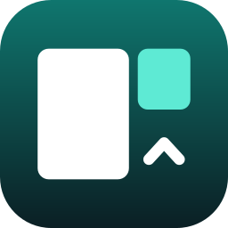
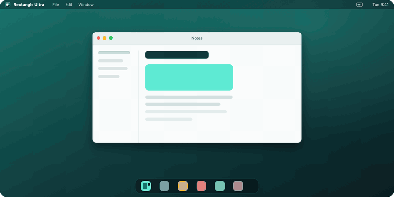
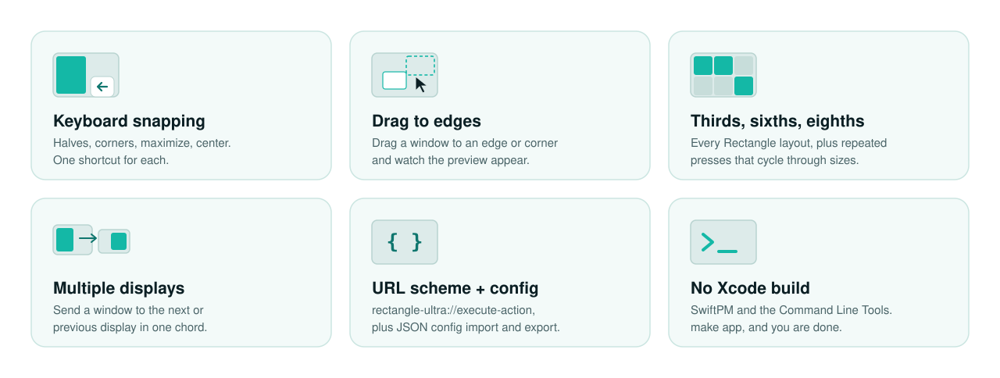
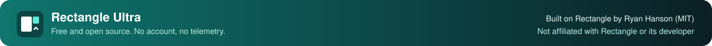

<p align="center">
  
</p>

<h1 align="center">Rectangle Ultra</h1>

<p align="center">
  <b>A free, open-source window manager for macOS.</b><br>
  Snap windows to halves, thirds, quarters and corners with a keyboard shortcut, or by dragging them to a screen edge.
</p>

<p align="center">
  <a href="https://github.com/esoteric-frog/RectangleUltra/actions/workflows/ci.yml"></a>
  
  
  <a href="https://github.com/esoteric-frog/RectangleUltra/releases/latest"></a>
  <a href="LICENSE"></a>
</p>

<p align="center">
  
</p>

<p align="center">
  <a href="https://esoteric-frog.github.io/RectangleUltra/"></a>
</p>

---

## Try it first

No Mac needed. The [**try-it page**](https://esoteric-frog.github.io/RectangleUltra/) has a small desktop you can play with. Press the shortcuts below and watch the windows snap into place.

## What it does

<p align="center">
  
</p>

- **Keyboard shortcuts** for halves, thirds, two-thirds, quarters, sixths, eighths, corners, maximize, almost maximize, center, restore, and next or previous display.
- **Drag to an edge** and a preview shows where the window will land.
- **Repeated presses cycle** sizes, so one shortcut can step through half, two-thirds and one-third.
- **Todo mode** keeps one app in a side column and tiles everything else beside it.
- **URL scheme** so scripts, Shortcuts and launchers can trigger any action.
- **JSON config** import and export, to move your setup between Macs.
- No auto-updater, no telemetry, no account. It runs entirely on your Mac.

## Install

**Download.** Get `RectangleUltra.zip` from the [latest release](https://github.com/esoteric-frog/RectangleUltra/releases/latest), unzip it, and drag **Rectangle Ultra** into Applications.

The app is ad-hoc signed, not notarized by Apple, so macOS will stop it on first launch. Either right-click the app and choose **Open**, or run:

```bash
xattr -dr com.apple.quarantine "/Applications/Rectangle Ultra.app"
```

Then allow it under **System Settings → Privacy & Security → Accessibility**. Rectangle Ultra needs that permission to move other apps' windows, and asks for it on first launch.

> [!NOTE]
> Quit any other window manager that uses the same shortcuts (Rectangle, for example) before running Rectangle Ultra, or the two will fight over the keys.
> Because the build is ad-hoc signed, macOS may ask for the Accessibility permission again after an update. Remove the old entry in the Accessibility list, then allow the new one.

**Build from source.** You do not need Xcode. The Command Line Tools are enough (`xcode-select --install`).

```bash
git clone https://github.com/esoteric-frog/RectangleUltra.git
cd RectangleUltra
make install      # builds "Rectangle Ultra.app" and copies it to /Applications
```

`make app` builds `build/Rectangle Ultra.app` without installing it, and `make test` runs the test suite. Requires macOS 14 or later.

## Default shortcuts

| Action | Shortcut | Action | Shortcut |
| --- | :---: | --- | :---: |
| Left half | <kbd>⌃</kbd> <kbd>⌥</kbd> <kbd>←</kbd> | Top left | <kbd>⌃</kbd> <kbd>⌥</kbd> <kbd>U</kbd> |
| Right half | <kbd>⌃</kbd> <kbd>⌥</kbd> <kbd>→</kbd> | Top right | <kbd>⌃</kbd> <kbd>⌥</kbd> <kbd>I</kbd> |
| Top half | <kbd>⌃</kbd> <kbd>⌥</kbd> <kbd>↑</kbd> | Bottom left | <kbd>⌃</kbd> <kbd>⌥</kbd> <kbd>J</kbd> |
| Bottom half | <kbd>⌃</kbd> <kbd>⌥</kbd> <kbd>↓</kbd> | Bottom right | <kbd>⌃</kbd> <kbd>⌥</kbd> <kbd>K</kbd> |
| Maximize | <kbd>⌃</kbd> <kbd>⌥</kbd> <kbd>↩</kbd> | First third | <kbd>⌃</kbd> <kbd>⌥</kbd> <kbd>D</kbd> |
| Center | <kbd>⌃</kbd> <kbd>⌥</kbd> <kbd>C</kbd> | Center third | <kbd>⌃</kbd> <kbd>⌥</kbd> <kbd>F</kbd> |
| Restore | <kbd>⌃</kbd> <kbd>⌥</kbd> <kbd>⌫</kbd> | Last third | <kbd>⌃</kbd> <kbd>⌥</kbd> <kbd>G</kbd> |
| Previous display | <kbd>⌃</kbd> <kbd>⌥</kbd> <kbd>⌘</kbd> <kbd>←</kbd> | First two-thirds | <kbd>⌃</kbd> <kbd>⌥</kbd> <kbd>E</kbd> |
| Next display | <kbd>⌃</kbd> <kbd>⌥</kbd> <kbd>⌘</kbd> <kbd>→</kbd> | Last two-thirds | <kbd>⌃</kbd> <kbd>⌥</kbd> <kbd>T</kbd> |

Every shortcut can be changed in Settings.

## Snap by dragging

Drag a window to the edge of the screen. When the pointer reaches the edge, a footprint shows where the window will land when you let go.

| Snap area | Result |
| --- | --- |
| Left or right edge | Left or right half |
| Top | Maximize |
| Corners | Quarter in that corner |
| Left or right edge, just above or below a corner | Top or bottom half |
| Bottom left, center or right third | That third |
| Bottom left or right third, then drag to bottom center | First or last two-thirds |

## Execute an action by URL

Open `rectangle-ultra://execute-action?name=[name]`. From a shell:

```bash
open -g "rectangle-ultra://execute-action?name=left-half"
```

Available values for `[name]`: `left-half`, `right-half`, `center-half`, `top-half`, `bottom-half`, `top-left`, `top-right`, `bottom-left`, `bottom-right`, `first-third`, `center-third`, `last-third`, `first-two-thirds`, `last-two-thirds`, `maximize`, `almost-maximize`, `maximize-height`, `smaller`, `larger`, `center`, `center-prominently`, `restore`, `next-display`, `previous-display`, `move-left`, `move-right`, `move-up`, `move-down`, `first-fourth`, `second-fourth`, `third-fourth`, `last-fourth`, `first-three-fourths`, `last-three-fourths`, `top-left-sixth`, `top-center-sixth`, `top-right-sixth`, `bottom-left-sixth`, `bottom-center-sixth`, `bottom-right-sixth`, `specified`, `reverse-all`, `top-left-ninth`, `top-center-ninth`, `top-right-ninth`, `middle-left-ninth`, `middle-center-ninth`, `middle-right-ninth`, `bottom-left-ninth`, `bottom-center-ninth`, `bottom-right-ninth`, `top-left-third`, `top-right-third`, `bottom-left-third`, `bottom-right-third`, `top-left-eighth`, `top-center-left-eighth`, `top-center-right-eighth`, `top-right-eighth`, `bottom-left-eighth`, `bottom-center-left-eighth`, `bottom-center-right-eighth`, `bottom-right-eighth`, `tile-all`, `tile-rows`, `tile-columns`, `cascade-all`, `cascade-active-app`, `cycle-stacked-windows`, `cycle-stacked-windows-backward`

URLs can also ignore or un-ignore an app. Ignoring an app means that while it is in front, Rectangle Ultra's shortcuts are released back to macOS. That is useful for apps that already use the same keys.

```
rectangle-ultra://execute-task?name=ignore-app
rectangle-ultra://execute-task?name=unignore-app
```

Add a bundle identifier to target a specific app:

```
rectangle-ultra://execute-task?name=ignore-app&app-bundle-id=com.apple.Safari
```

You can also ignore the front app from the Rectangle Ultra menu: choose **Ignore app**, and choose it again to undo.

## Terminal settings

Many hidden preferences can be set with `defaults write`. See [TerminalCommands.md](TerminalCommands.md).

## Import and export

The **App Settings** tab in Settings has buttons to import and export your shortcuts and preferences as a JSON file.

## Troubleshooting

- **Shortcuts do nothing.** Check that Rectangle Ultra is enabled under **System Settings → Privacy & Security → Accessibility**. If it is listed and still does nothing, switch it off, remove it with the minus button, then add it again.
- **Two apps react to the same shortcut.** Quit the other window manager, or change the shortcuts in one of them.
- **A window will not resize exactly.** Some apps, terminals especially, snap to a character grid and land a few pixels short. That is the app, not the window manager.
- **Logs.** Hold <kbd>⌥</kbd> while the Rectangle Ultra menu is open and choose **View Logging…**.

## Uninstall

Quit the app and delete it from Applications.

## Roadmap

Planned, **not built yet**:

- Stash windows at a screen edge
- Window throw: a keyboard picker to send a window to a spot
- A snap-area panel
- Saved layouts and per-app rules

## Contributing

Bug reports and small, focused fixes are welcome. See [CONTRIBUTING.md](CONTRIBUTING.md). Report security issues as described in [SECURITY.md](SECURITY.md). Version history is in [CHANGELOG.md](CHANGELOG.md).

## Credits

Rectangle Ultra is a fork of [**Rectangle**](https://github.com/rxhanson/Rectangle) by Ryan Hanson, released under the MIT license. Nearly everything that makes it work comes from that project and its contributors. If you want the original, polished and widely used app, go and use it. Rectangle is itself based on Spectacle.

[MASShortcut](https://github.com/shpakovski/MASShortcut) is vendored for recording keyboard shortcuts, with a small fix so it finds its resources outside an Xcode build.

## License

MIT. See [LICENSE](LICENSE).

<p align="center">
  
</p>

<p align="center"><sub>Not affiliated with Rectangle, Rectangle Pro or their developer.</sub></p>
